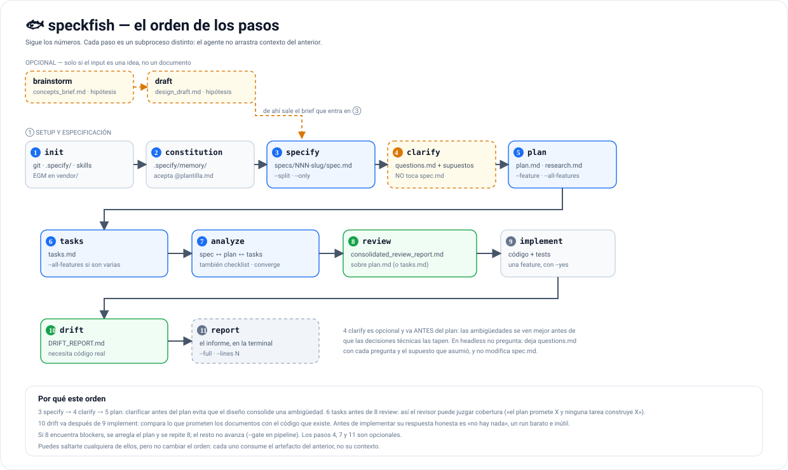
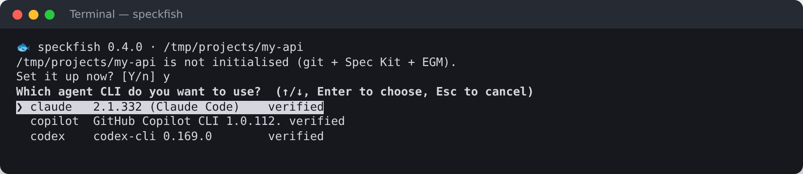
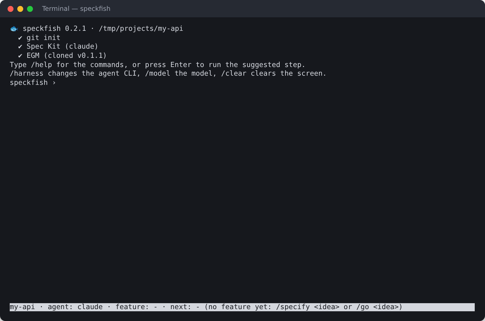
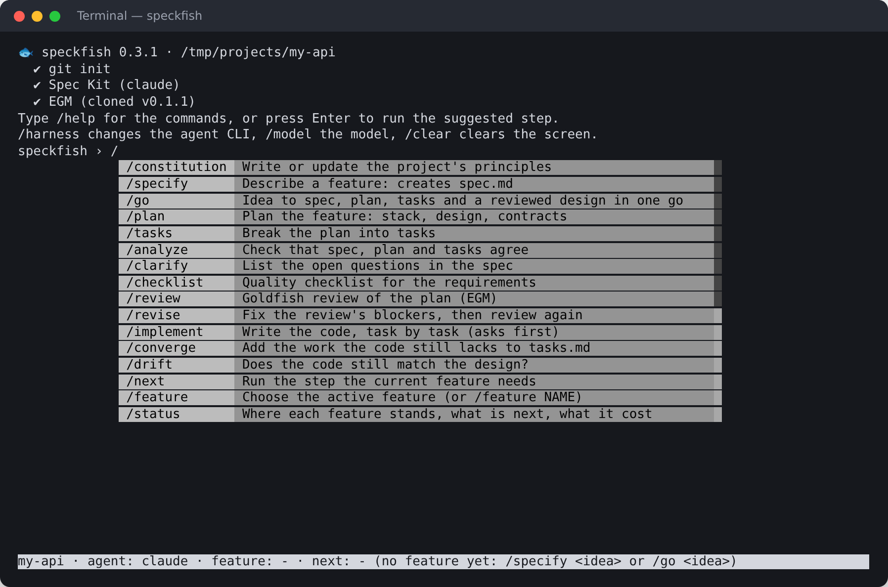
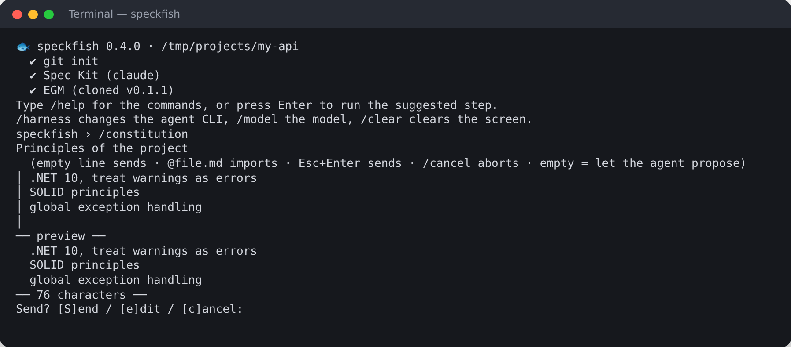
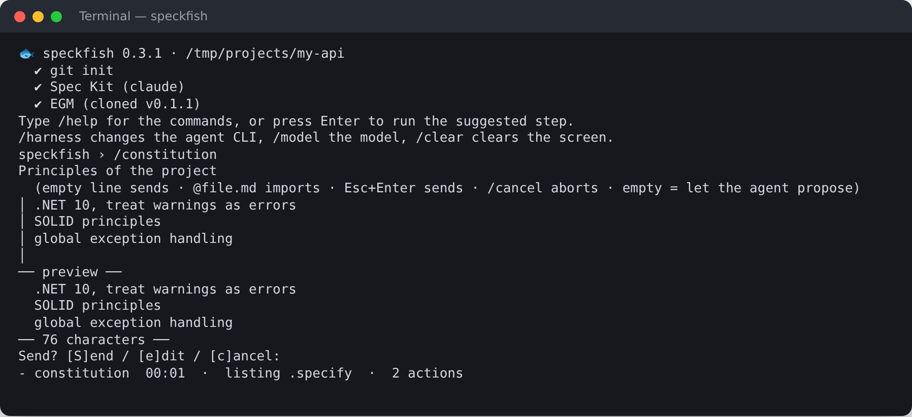
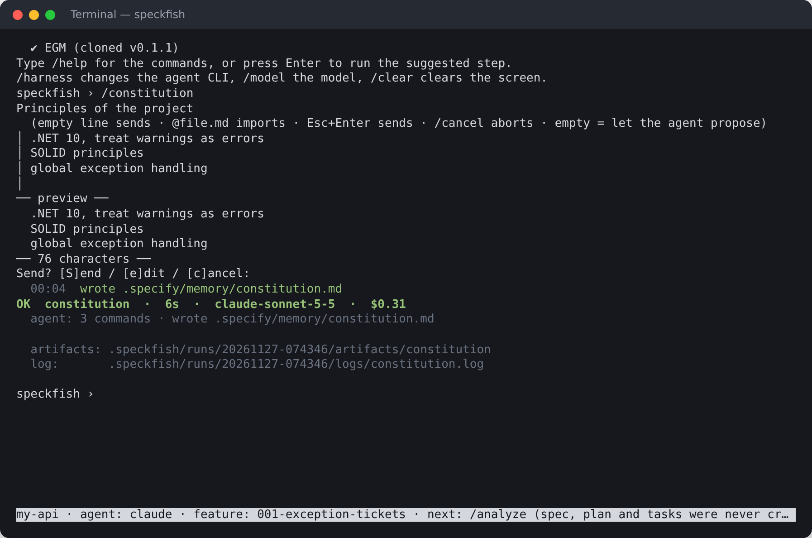
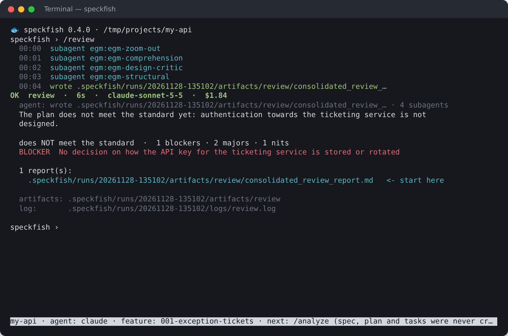
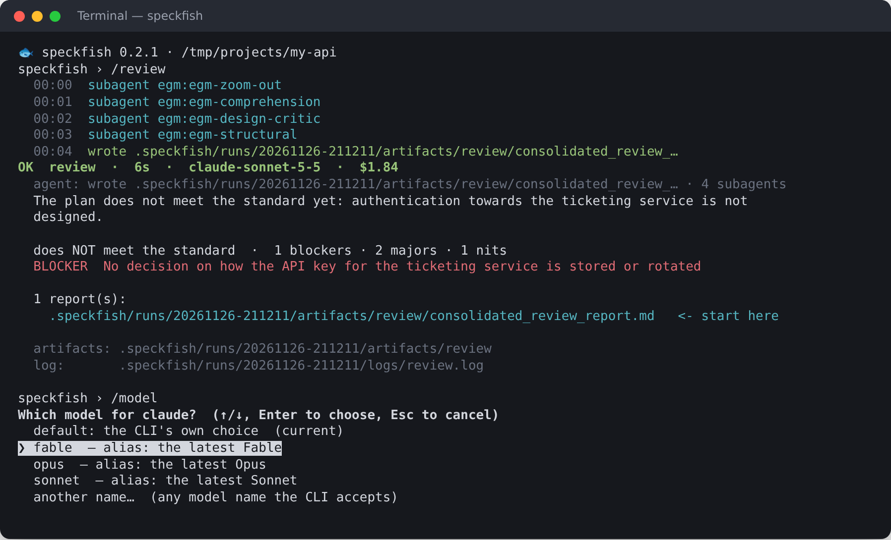

# speckfish 🐟

**Headless orchestrator for [Spec Kit](https://github.com/github/spec-kit) + [Elephant-Goldfish Model (EGM)](https://github.com/google/elephant-goldfish-model) over agent CLIs.**

[](https://github.com/jamartif/speckfish/actions/workflows/tests.yml)
[](https://github.com/jamartif/speckfish/releases)
[](pyproject.toml)
[](LICENSE)

`speckfish` turns the "specify → plan → review with Goldfish" loop into commands you can run
from a terminal or from CI. One agent subprocess per step, per-run artifacts, a
machine-readable verdict and exit codes you can automate against.



```
speckfish pipeline "a task CLI in Python" --stack "stdlib only" --gate
```

## Quick start

```bash
uv tool install "speckfish[tui] @ git+https://github.com/jamartif/speckfish"
cd my-project
speckfish
```

`speckfish` on its own opens a **console that takes the whole terminal** (like `vim` or `less`: when you leave,
your terminal is exactly as it was). The first time it offers to set the project up (git, Spec Kit and EGM) and
asks which agent CLI to use:



When it is done the screen is cleared and you are at the prompt. Type `/` for the menu, or press Enter to run the
step speckfish suggests next. The bar at the bottom always shows where you are and what comes next:





> **About the screenshots.** They are real runs of speckfish in a real terminal (110×32): the wizard, `specify
> init`, the pinned EGM checkout, the menus and the result parsing are all the real code. The *agent* is a
> scripted stand-in that plays a short fixed session, so the images cost nothing, need no login and look the same
> every time. Regenerate them with `python docs/screenshots/capture.py`.

## The flow at a glance

```mermaid
flowchart LR
    O["(optional) brainstorm / draft<br/><small>only when the input is a vague idea</small>"] -.-> SPEC
    INIT["1 · init<br/><small>git · .specify · EGM in vendor/</small>"] --> CONST
    CONST["2 · constitution<br/><small>@template.md</small>"] --> SPEC["3 · specify<br/><small>--split · --inventory-only · --only</small>"]
    SPEC --> PLAN["4 · plan<br/><small>--feature · --all-features</small>"]
    PLAN --> TASKS["5 · tasks<br/><small>also analyze / checklist / clarify</small>"]
    TASKS --> REV{"6 · review<br/><small>goldfish review of the plan</small>"}
    REV -->|"blockers → exit 1"| FIX["fix the plan"] --> REV
    REV -->|"no blockers"| IMPL["7 · implement<br/><small>code + tests, one feature</small>"]
    IMPL --> DRIFT["8 · drift<br/><small>design vs the code that now exists</small>"]
    DRIFT --> REP["9 · report<br/><small>the findings, in the terminal</small>"]
    REP --> CI["CI gate<br/><small>exit 0 / 1 / 2 / 3</small>"]

    classDef step fill:#eff6ff,stroke:#1b6ef3,stroke-width:1.5px,color:#0f172a
    classDef gate fill:#fffbeb,stroke:#d97706,stroke-width:1.5px,color:#0f172a
    classDef out fill:#f0fdf4,stroke:#16a34a,stroke-width:1.5px,color:#0f172a
    classDef soft fill:#f1f5f9,stroke:#94a3b8,stroke-width:1.2px,stroke-dasharray:5 4,color:#0f172a
    class INIT,CONST,SPEC,PLAN,TASKS step
    class REV,FIX gate
    class IMPL,DRIFT,REP,CI out
    class O soft
```



Every step runs as its own subprocess, so the agent never drags context from the previous step:

```mermaid
sequenceDiagram
    autonumber
    participant CLI as speckfish
    participant SK as Spec Kit skills
    participant AG as agent CLI (claude / copilot / codex)
    participant GF as EGM goldfish subagents
    participant FS as .speckfish/runs/&lt;id&gt;/

    CLI->>AG: subprocess #1 with /speckit-specify
    AG->>SK: writes spec.md + checklists
    AG-->>FS: logs/specify.log, result JSON
    CLI->>AG: subprocess #2 with /speckit-plan
    AG->>SK: writes plan.md, research.md, contracts/
    CLI->>AG: subprocess #3 with /speckit-tasks
    AG->>SK: writes tasks.md
    CLI->>AG: subprocess #4 with /egm:egm-review
    AG->>GF: spawn reviewer (clean context, read-only tools)
    GF-->>AG: findings per stage
    AG-->>FS: artifacts/review/*.md + verdict
    CLI-->>CLI: parse verdict → blockers / majors / nits → exit code
    CLI-->>CLI: speckfish report prints the findings in the terminal
```

### What runs before what

The numbers in the diagram are the order, and two of them are not obvious:

| Step | Needs | Why it is there |
|---|---|---|
| 3b · `clarify` | `spec.md` | Optional, **before** `plan`: headless it cannot answer, so it writes `questions.md` with every question *and the default it assumed*, and leaves the spec untouched. Read it, accept or edit, then plan. |
| 5 · `tasks` | `plan.md` | Run it **before** the review: the reviewer can then judge coverage ("the plan promises X, no task builds X"). A review of a plan with no task list cannot catch missing work. |
| 6 · `review` | `plan.md` (+ `tasks.md`) | Reviewing the spec alone only yields "this is ambiguous"; the plan is where technical decisions exist to be criticised. |
| 7 · `implement` | `tasks.md` | Writes code. One feature at a time, gated behind `--yes`. |
| 8 · `drift` | documents **and code** | It compares what the documents promise with the code that exists. **After implement**, never before: with no code the honest answer is "nothing is implemented", a cheap but useless run. |

`clarify` is optional and sits **before** `plan`; `analyze`, `checklist` and `converge` are optional and
sit **after** `tasks` (they check spec ↔ plan ↔ tasks consistency); `brainstorm`/`draft` are the only
steps that come *before* `specify`, and only when the input is an idea rather than a document.

Two steps can be chained so you type less, without fusing them into one agent run:

```bash
speckfish plan "stack" --feature 001 --with-clarify     # clarify first, then STOP if it left questions
speckfish plan "stack" --feature 001 --with-clarify --accept-defaults   # plan anyway
speckfish review specs/001-*/plan.md --with-analyze     # cheap Spec Kit analyze before the EGM review
```

`--with-clarify` stopping is the point: planning on top of unreviewed assumed defaults is how a design
consolidates a misunderstanding. `--with-analyze` is the opposite case — `analyze` is cheap and catches
spec ↔ plan ↔ tasks gaps before you pay for a goldfish review.

## What it solves

- **Spec Kit** produces `spec.md` and `plan.md`, but nobody reviews them with a critical eye.
- **EGM** reviews with clean-context "goldfish" subagents, but its flow is interactive.
- `speckfish` joins both and runs them non-interactively, keeping every artifact the agent writes.

## Status (verified with real runs)

| Harness | Status | Evidence |
|---|---|---|
| **Claude Code** | ✅ Verified end-to-end | `specify` → `plan` → `egm-review` (7 subagents via `Agent`) → `egm-drift-report`; verdict through `--json-schema`; ~$0.85-1.04 per review |
| **GitHub Copilot CLI** | ✅ Verified end-to-end | full review: **10 subagents**, 0 blockers with the `speckit` profile, 8 majors; 4.9 AI credits, wall clock ~6m55s; drift in 0.63 credits / 64 s |
| **Codex CLI** | ✅ Verified for the Spec Kit steps · ❌ not for the EGM review | With a local OpenAI-compatible provider (`nan.builders`, `deepseek-v4-flash`): `init`, `doctor`, `constitution` (2m27s), `specify --split` (inventory 75s, then 6-9 min per spec), `plan` (plan + research + data-model) and `tasks` (401 lines, 139 tasks). The EGM review **did not converge**: it wrote two stage reports and then looped on `collab: SpawnAgent / Wait` (killed at 10 min). Requires `wire_api = "responses"`, and 0.169 ignores `--sandbox workspace-write`, so the adapter bypasses approvals. |

`speckfish` counts the subagents launched by each run (Claude: `subagent_stats.spawned`;
Copilot: `subagent.started` events) and stores it in the step result. That is the evidence that
a review was a real Goldfish review and not a same-context review.

**Harness vs provider — two different things.** The *harness* is the agent CLI that runs a step
(`claude`, `copilot`, `codex`). The *provider* is where its model comes from. Running `codex` against
`nan.builders` is still `--harness codex`: nan only decides which model answers. That combination is
verified for the Spec Kit steps above and **not** for the EGM review, because the review depends on an
agent that coordinates subagents (see the table).

EGM documents its Copilot adapter as **experimental** (reviewer isolation unverified by Google).
`speckfish` does not fix that: it records it.

## Install

```bash
# with uv (recommended). The [tui] extra adds the / menu, completion and the arrow-key pickers
uv tool install "speckfish[tui] @ git+https://github.com/jamartif/speckfish"

# or with pipx
pipx install "speckfish[tui] @ git+https://github.com/jamartif/speckfish"

# or from a clone
git clone https://github.com/jamartif/speckfish && cd speckfish
uv venv && uv pip install -e ".[tui]"
```

Without the `[tui]` extra everything still works with plain prompts (numbered choices instead of arrows). To update,
run the same command again with `--force`. If `speckfish` runs an old version, `where.exe speckfish` (Windows) or
`which -a speckfish` shows which copy comes first on your `PATH`.

Prebuilt wheels and sdists are attached to every release:
see <https://github.com/jamartif/speckfish/releases>.

Requirements: Python ≥ 3.10, plus the agent CLI you intend to use:

| Harness | Install | Login |
|---|---|---|
| Claude Code | `npm i -g @anthropic-ai/claude-code` | `claude` (once) |
| Copilot CLI | `npm i -g @github/copilot` | `copilot login` |
| Codex CLI | `npm i -g @openai/codex` | `codex login` |

Spec Kit is discovered automatically: the `specify` binary is used when it works and, if it is
blocked by Windows policies, `speckfish` falls back to `uv tool run --from specify-cli specify`.

### If the `speckfish.exe` launcher is blocked (Windows Device Guard / App Control)

Some managed Windows machines block the unsigned console-script `.exe` that pip/uv generates
(`'speckfish.exe' has been blocked by your organization's Device Guard policy`), while `python.exe`
runs fine. `uv tool install` puts the package in its own isolated venv, so `python -m speckfish`
fails with a plain `python` on PATH ("No module named speckfish") — pick one of these:

```powershell
# A) no installation at all
uv tool run --from git+https://github.com/jamartif/speckfish python -m speckfish doctor

# B) the interpreter of the installed tool
& "$env:APPDATA\uv\tools\speckfish\Scripts\python.exe" -m speckfish doctor

# C) install into a regular interpreter once, then `python -m speckfish` works in any folder
py -3.12 -m pip install --user git+https://github.com/jamartif/speckfish
python -m speckfish doctor

# D) or drop docs/speckfish.bat in a folder on PATH and run the plain command
speckfish doctor
```

Two Windows details worth knowing:

- `PATHEXT` resolves `.EXE` before `.BAT`, so a `speckfish.bat` never wins over the blocked
  `speckfish.exe`. Either `uv tool uninstall speckfish` (removing the stub) or call the `.bat`
  by another name.
- The `--user` install also generates an `.exe`; it is harmless because you never call it —
  `python -m speckfish` bypasses it.

On macOS and Linux the regular `speckfish` command works.

### Which agents does `init` set up?

`specify init --integration X` writes the Spec Kit skills **for one agent only** and records it in
`.specify/integration.json`. By default `speckfish init` picks every agent CLI it finds installed
(`claude`, `copilot`, `codex`) and runs Spec Kit once per integration; the skills land in each
agent's own folder:

| Integration | Where the skills go |
|---|---|
| `claude` | `.claude/skills/speckit-*` |
| `copilot` | `.github/skills/speckit-*` |
| `codex` | `.agents/skills/speckit-*` |

```bash
speckfish init                       # auto: every installed agent CLI
speckfish init --integration all     # claude + copilot + codex, even if a CLI is missing
speckfish init --integration copilot,claude
```

Two caveats worth knowing, both measured on Spec Kit 1.3.2:

- `integration.json` keeps only the **last** integration that ran (`installed_integrations` shows
  one entry). The previously written skill folders stay on disk and keep working; re-run
  `speckfish init` if that file drifts.
- Passing `--integration` twice to `specify` in one call does not merge: the last one wins. That is
  why `speckfish` runs Spec Kit once per integration instead of a single combined call.
- If an agent CLI is not installed, `speckfish` adds `--ignore-agent-tools` so Spec Kit still writes
  its skills instead of aborting.

EGM is independent of this: it is a single plugin mounted with `--plugin-dir vendor/egm`, so the
review works with any of the three agents regardless of which Spec Kit integration you installed.

## Usage

### Interactive console

`speckfish` with no arguments in a terminal opens the console (`speckfish shell` does the same explicitly). In a
pipe or in CI it still prints the usage, so scripts do not change.

**Full screen.** The console uses the terminal's alternate screen: you do not see the commands you ran before,
and on exit the terminal comes back as it was. That screen has no scrollback of its own, so anything longer than
the window (`/help`, a long report) goes through a small pager (`Enter` for more, `q` to skip) and everything a step
does is also on disk under `.speckfish/runs/`. `/clear` redraws the screen. Turn it off with
`speckfish config fullscreen=false` or `SPECKFISH_FULLSCREEN=0`; it is also off when the terminal cannot take
escape codes.

**Free-text steps open an editor.** `/constitution`, `/specify`, `/plan`, `/go` and `/brainstorm` ask for their text
when you do not give it: type as many lines as you like, finish with an empty line, or give `@file.md` to import a
file (completion lists the files of the project). You get a preview before anything is sent:



**You see what it is doing, in words.** While the agent works there is one live line that updates itself (clock,
step, what it is doing, how many actions), and only the milestones stay on screen. The step then ends with a
summary of the outcome:





A review shows its verdict, the counts and every blocker, in colour when the terminal supports it:



`OK` means the *step* ran; whether the document passes is the verdict line (`does NOT meet the standard`) and the
exit code (`1` with blockers in the command line).

**The commands.** Every `/command` is the same subcommand you would type in the shell, so nothing works differently
inside the console; the menu is generated from the CLI's own parser, so a new subcommand appears there by itself.

| In the console | What it does |
|---|---|
| `/constitution` · `/specify` · `/plan` · `/tasks` · `/go` | the Spec Kit steps; `/go` takes an idea all the way to a reviewed design |
| `/review` · `/revise` · `/drift` · `/analyze` · `/clarify` | verify the design and the code |
| `/implement` | writes code; asks first and shows what the agent will be allowed to do |
| `Enter` on an empty line | runs the step speckfish suggests next (it asks first) |
| `/feature [NAME]` | choose the active feature (a picker, or by name or number) |
| `/harness [NAME] [--save]` | choose the agent CLI: claude, copilot or codex |
| `/model [NAME] [--save]` | choose the model (see below) |
| `/verbose [on\|off]` | keep every action on screen, not only the milestones |
| `/status` · `/features` · `/runs` · `/report` · `/doctor` · `/config` | inspection |
| `/clear` · `/help` · `/exit` | housekeeping (`Ctrl+D` also leaves) |

Any line that does not start with `/` is treated as an idea and offered as `/go <idea>` (it asks first).
`Ctrl+C` stops the running step and returns to the prompt; `/harness` and `/model` last for the session unless you
add `--save`.



**Models.** None of the three CLIs has a command that lists its models, so nothing is invented: Claude offers the
aliases its own `--help` documents (`fable`, `opus`, `sonnet`), Copilot the `choices` its `--help` prints, Codex the
model set in `~/.codex/config.toml`; every picker also has `default` (the CLI's own choice) and *another name…*.

### The short way: `go`

```bash
speckfish go "a task CLI in Python" --stack "stdlib only"   # idea -> specs -> plans -> tasks -> analyze -> review/revise
speckfish go @brief.md --budget 30                           # long briefs are split into features automatically
speckfish go --implement --yes                               # resume, and also write the code and check drift
speckfish status                                             # where every feature stands, what is next, what it cost
speckfish next                                               # run only the one step the current feature needs
speckfish revise --max-rounds 2                              # review -> fix the blockers -> review again
```

`go` works out what is missing from the files in `specs/` and from what earlier runs recorded, so it
is the same command to start and to resume. A review only counts while the design has not changed
since; `revise` hands the review report back to the agent, which fixes the Blockers (add `--majors`
for the Majors too) and the review runs again, up to `--max-rounds`. With `--implement` it also
implements in chunks of `--chunk` tasks (default 5, each ticked in `tasks.md`), checks drift and, if the code diverged, appends the missing work (`converge`) and
implements once more. `--budget` stops before the next step once that much was spent. Exit codes:
`0` clean · `1` blockers left after the rounds · `2` a step failed · `3` quota, credentials or budget.

### Tasks only a person can do, and tasks the agent cannot finish

- Mark a task `[MANUAL]` in `tasks.md` (e.g. `- [ ] T002 [MANUAL] Measure on the phone`) and `implement` never hands it to the agent; when only those are left the loop ends and lists them as yours. `status` shows `(+N yours)`.
- The agent is asked to end with `BLOCKED: <task id> - <reason>` for any task it cannot finish. A chunk that ticks nothing and says so is reported as `blocked` (exit code 3) with the agent's words, and is not retried.
- Before `implement` starts, the project's build tools are checked (from the project's files and from the stack in the feature's `plan.md`: `gradlew`/Kotlin → java, `package.json` → node, `Cargo.toml` → cargo, `go.mod`, `*.csproj`, `pom.xml`…). Add your own with `speckfish config require_tools "java,adb"`; `SPECKFISH_SKIP_TOOL_CHECK=1` turns it off.
- Each Spec Kit step checks that the agent in use has its skills in the project (`speckfish doctor` shows which agents do); if not, it tells you to run `speckfish init --integration <agent>`. `SPECKFISH_SKIP_SKILL_CHECK=1` turns the check off.

### Step by step

```bash
speckfish doctor                    # environment, harness, specify and EGM
speckfish init                      # git init + specify init + clone EGM into vendor/egm
speckfish init --integration all    # install Spec Kit skills for claude, copilot and codex

# Spec Kit, step by step
speckfish constitution "tests first, no hidden state"   # project principles
speckfish specify "a JSON task CLI"
speckfish plan "Python 3.12, stdlib only"
speckfish tasks                     # tasks.md from the design
speckfish analyze                   # spec vs plan vs tasks consistency
speckfish checklist "error handling"
speckfish clarify                   # open questions (writes questions.md when headless)
speckfish implement --yes           # DESTRUCTIVE: writes code and tests
speckfish converge                  # append whatever the code still misses to tasks.md

# EGM review
speckfish review                    # reviews plan.md of the latest feature
speckfish review --profile none     # literal review against the EGM standard
speckfish review --interactive      # EGM asks, you answer
speckfish drift                     # drift between spec/code

speckfish pipeline "idea" --stack "..." --gate --with-drift
speckfish pipeline "idea" --stack "..." --with-tasks --with-analyze --gate

# housekeeping
speckfish --version
speckfish config                         # show project defaults
speckfish config harness=copilot         # store them in .speckfish/config.json
speckfish runs                           # steps, cost and duration per run
speckfish show                           # per-step table + run total
speckfish runs --clean --keep 5          # prune old runs
```

Every Spec Kit skill is a subcommand (the same nine `speckit-*` skills the integration installs).
`implement` is the only destructive one: it refuses to run without `--yes`.

Global flags (before or after the subcommand): `--root`, `--harness claude|copilot|codex`,
`--json`, `--quiet`, `--dry-run`.

When a step fails, the error is a sentence you can act on — never the agent's payload:

```
FAILED  review  ·  6s  ·  exit 1
  ERROR  the agent ran out of quota (HTTP 429): You've hit your weekly limit · resets 8pm (Europe/Madrid)
  fix: wait for the limit to reset, or run the same step with another agent (`--harness copilot`).
       Nothing was lost: retry the same command.
```

Out of quota (HTTP 429) and bad credentials (401/403) exit with **3** (environment), so a script can
tell "the document has problems" apart from "the agent could not run". The agent's full output stays
in `.speckfish/runs/<id>/logs/`.

## Command reference

Global flags accepted by every command (before or after the subcommand):

| Flag | What it does |
|---|---|
| `--root <path>` | project root (default: cwd). `~` and `/c/…` are resolved on Windows |
| `--harness claude\|copilot\|codex` | which agent CLI runs the steps (default: the first installed) |
| `--model <name>` | forwarded to the agent CLI; otherwise the CLI picks its own |
| `--json` | machine-readable output on stdout |
| `--fallback <agent>` | if a step stops for quota or credentials, retry it once with this agent |
| `--no-progress` / `--quiet` / `--dry-run` | silence the live line / the agent echo / run nothing, print the command |
| `--verbose` | keep every action the agent takes on screen, not only the milestones |
| `--unsafe` | accept an agent that runs with no sandbox (codex) for this run |
| `--allow-outside-root` | let `@file` read files outside the project folder |
| `--stream` | forward the agent's own output (on by default) |

**Setup and inspection**

| Command | Options | What it does |
|---|---|---|
| `init` | `--integration claude\|copilot\|codex\|all\|list` · `--no-egm` · `--egm-ref` · `--no-editors` · `--prefix` | git + `specify init` + EGM in `vendor/` + editor commands |
| `doctor` | — | versions of specify/EGM/harness, whether EGM is the pinned commit and trusted, project state |
| `trust` | `--path` · `--show` | trust the EGM checkout this project uses (it runs with the agent's permissions) |
| `shell` | — | the interactive console (what `speckfish` alone opens in a terminal) |
| `features` | — | every feature under `specs/`, its artifacts and which one is active |
| `config [key=value]` | e.g. `config timeout.revise=3600`; see [Settings](#settings-and-environment-variables) | show or store project defaults |
| `runs` / `show` | `runs --clean --keep N` | list runs / detail one run |
| `editors` | `--targets` · `--command` · `--prefix` · `--codex-home` · `--no-force` | VS Code tasks, Copilot prompts, Claude commands, Codex prompts |

**Explore (optional, EGM)**

| Command | Options | What it does |
|---|---|---|
| `brainstorm <idea\|@file>` | `--run-id` | `concepts_brief.md`: alternatives, risks, hypotheses |
| `draft <concept\|@file>` | `--run-id` | `design_draft.md`: design sketch (conversational) |

**Specify (Spec Kit)**

| Command | Options | What it does |
|---|---|---|
| `constitution [principles\|@file]` | `--feature` | `.specify/memory/constitution.md` |
| `specify <desc\|@file>` | `--split` · `--max-features N` · `--inventory-only` · `--only 4,5,6` · `--from-feature N` · `--review` | `specs/NNN-slug/spec.md`, one per feature with `--split` |
| `plan [stack\|@file]` | `--feature` · `--all-features` | `plan.md`, `research.md`, `data-model.md`, `contracts/` |
| `tasks` | `--feature` · `--all-features` | `tasks.md` |
| `analyze` · `checklist` · `clarify` · `converge` | `--feature` (`analyze` also `--all-features`) | cross-check, checklist, clarification questions, remaining work |

**Verify (EGM)**

| Command | Options | What it does |
|---|---|---|
| `review <doc>` | `--profile` · `--stage` · `--target-file` · `--interactive` | goldfish review → `consolidated_review_report.md` + verdict |
| `drift <dir>` | — | design vs code → `DRIFT_REPORT.md` |
| `report` | `--full` · `--lines N` | print the report in the terminal |
| `pipeline <desc>` | `--stack` · `--target` · `--gate` · `--with-tasks` · `--with-analyze` · `--with-drift` | the chain with one run id |

**Ship**

| Command | Options | What it does |
|---|---|---|
| `implement` | `--feature` · `--yes` | writes code and tests (one feature, gated on purpose) |

### A complete worked example

A 230-line requirements document with seven consolidated specs, run on a local OpenAI-compatible model
(`codex --harness codex`), with the review moved to Copilot because the EGM chain needs an agent that
coordinates subagents:

```bash
speckfish init --integration codex,copilot
speckfish config language=es

speckfish constitution @constitution-template.md --harness codex      # 2m27s → 195 lines, 15 principles
speckfish specify @requirements.md --split --max-features 7 \
        --inventory-only --harness codex                              # 75s → specs/features.json (7 features)
# read specs/features.json, drop or merge what you disagree with, then:
speckfish specify --split --only 4,5,6,7 --harness codex              # ~8 min per feature, resumable

speckfish plan "C# .NET 10, Minimal API, PostgreSQL, xUnit" \
        --all-features --harness codex                                # plan.md + research.md + data-model.md
speckfish tasks --all-features --harness codex                        # tasks.md (401 lines, 139 tasks measured)

speckfish review specs/001-*/plan.md --harness copilot                # ~7 min, 4.9 AI credits
speckfish report                                                      # verdict + counts + where the report is

speckfish implement --feature 001 --harness copilot --yes             # code + tests, one feature at a time
speckfish drift specs/001-* --harness copilot
```

What the console shows while that runs, and what it ends with:

```
[specify-4] 00:13 | $ Get-Content -Raw .agents/skills/speckit-specify/SKILL.md
[specify-4] 02:04 | wrote specs/004-external-escalation-test-mode/spec.md

4 spec(s) generated
  specs/004-external-escalation-test-mode/spec.md
  …

  run 20261114-230243  ·  34m12s
```

### Watching it work

A three-minute silent subprocess looks like a hang, so while the agent runs there is **one live line** that
updates itself in place, cut to the width of your terminal so it never wraps. It describes what the agent is
doing in plain words instead of dumping its commands:

```
| constitution  00:21  ·  listing .specify  ·  7 actions
```

`[System.IO.File]::ReadAllText('C:\\Users\\me\\proj\\.agents\\skills\\speckit-constitution\\SKILL.md')` shows as
`reading .agents/skills/speckit-constitution/SKILL.md`, `git status --short; git log …` as `git status`,
`rg --files -g '*.csproj'` as `searching the project`.

Only the **milestones stay on screen**: files written or edited, subagents started, warnings. Reads, listings and
commands only move the live line. `--verbose` (or `SPECKFISH_VERBOSE=1`, or `/verbose` in the console) keeps every
action. The activity comes from the CLI's own events, so it is real: which command ran, which file was written,
which subagent started.

Without a terminal (CI, a pipe) there is no live line: every action is one plain line, easy to grep:

```
[specify-1] 00:13 | $ Get-Content -Raw .agents/skills/speckit-specify/SKILL.md
[specify-1] 00:21 | $ Get-ChildItem -Force -Recurse specs
[specify-1] 02:04 | wrote specs/001-api-v1-platform-foundation/spec.md
```

Agent JSON is never echoed: whole JSON lines and anything over 1200 characters stay in the log. When the step ends
the line is erased and the summary takes over, including what the agent did (`agent: 14 commands · wrote
.specify/memory/constitution.md · 2 subagents`). Everything the agent printed is in
`.speckfish/runs/<id>/logs/<step>.log`, and `<step>.meta.json` next to it records how the step was run (agent and
version, arguments without the prompt, the prompt's length and hash, permissions, EGM commit and trust, cost).
Turn the live line off with `--no-progress` (implied by `--quiet` and `--json`). Colour is only used on a terminal;
`NO_COLOR` turns it off.

**Sleep and standby.** If the computer is suspended while a step runs (sleep, hibernation, Modern Standby with the
lid closed) everything is frozen, agent included. speckfish notices the pause, does not count it as the agent being
silent or as part of the duration, and says so (`the computer was suspended for 4h 08m; that time is not counted`).
For a long run overnight keep the machine awake: sleeping is Windows' decision, not something speckfish can prevent.

**Ctrl+C.** It prints `Stopping the agent…`, stops the *whole* tree of processes the agent started, and checks
that it is gone; if it could not, it says so and prints the exact command to do it by hand. A second Ctrl+C
forces it.

### Reading the outcome

The console shows a summary, never the agent's raw JSON. For a review that is:

```
OK  review  ·  3m22s  ·  claude-sonnet-5-5  ·  $1.29
  Apto con cambios. No hay Blockers. Hay 9 acciones Major consolidadas y varios Nits.

  does NOT meet the standard  ·  0 blockers · 9 majors · 7 nits

  5 report(s):
    .speckfish/runs/20261113-211218/artifacts/review/consolidated_review_report.md   <- start here
    .speckfish/runs/20261113-211218/artifacts/review/comprehension_report.md
    ...

  artifacts: .speckfish/runs/20261113-211218/artifacts/review
  log:       .speckfish/runs/20261113-211218/logs/review.log
```

The verdict is the headline, the counts are one line, paths are relative to the project. To read the
report without leaving the terminal:

```bash
speckfish report              # consolidated report of the latest run (first 40 lines)
speckfish report --full       # the whole thing
speckfish report 20261113-211218 --lines 100
```

### Exploring before you specify (EGM brainstorm / draft)

Spec Kit turns a decided idea into requirements; it does not explore alternatives. That is what EGM's
two exploration skills are for, and they are exposed as commands:

```bash
speckfish brainstorm "an incident manager for small teams" --harness claude   # -> concepts_brief.md
speckfish draft @concepts_brief.md --harness claude                          # -> design_draft.md
```

EGM's own chain is `brainstorm → draft → review`, and it feeds a spec, not replaces it:

```
brainstorm (concepts_brief.md) → draft (design_draft.md) → specify (spec.md) → plan
```

- **Use them when the input is a vague idea.** With requirements already consolidated, exploring is
  wasted work: those decisions are taken.
- Both are **conversational by design** — `egm-draft` asks "how would you like to proceed?" between
  sections. Headless they still write the artifact, but every unconfirmed decision is marked as a
  hypothesis. Read it as a draft, never as a decision.
- `draft` overlaps with `plan`: Spec Kit's plan is the technical design that tasks are built from, and
  it is written for the implementation, not for exploration. Running both is duplicating.

### One feature at a time (or all of them)

Spec Kit works on **one feature at a time**: the one in `.specify/feature.json`. That means
`speckfish plan`, `tasks`, `analyze`, `checklist`, `converge` and `implement` all act on the *active*
feature — by default the last one you specified, not on every spec in the repo.

```bash
speckfish features                       # what exists, what each one has, which one is active
speckfish plan "Swift 6" --feature 002   # switch the active feature and plan that one
speckfish tasks --feature 002            # same idea for any other step
speckfish implement --yes --feature 002
```

```
$ speckfish features
  001-json-task-cli                  [++-]
  002-open-remember-repos            [+--]
  003-safe-staging-commit            [+--]
* 009-settings-preferences           [+--]

* active (Spec Kit will work on it)   [+spec +plan +tasks]
```

`--feature` accepts a number (`002`), a directory name (`002-open-remember-repos`) or a path, and it
**writes `.specify/feature.json`** — the same file Spec Kit reads — plus tells the agent in the prompt
which folder to work on. A missing feature fails with the list of what exists instead of guessing.

**Every feature-oriented step** (`plan`, `tasks`, `analyze`, `clarify`, `checklist`, `converge`,
`review`, `drift`) takes the same four flags, so resuming works the same everywhere:

| Flag | Meaning |
|---|---|
| `--feature 003` | just that one (number, name or path) |
| `--only 2,4,5` | these, by position in `specs/` |
| `--from-feature 4` | this one onwards |
| `--all-features` | every feature, in order |
| `--skip-existing` | skip the ones that already have this step's artifact |

```bash
speckfish tasks --only 2,4 --harness codex        # redo just these
speckfish tasks --from-feature 4 --skip-existing  # carry on where it stopped
speckfish review --only 1 --harness copilot       # review one feature
```

To run a step over **every** feature, `plan`, `tasks` and `analyze` accept `--all-features`: they walk
`specs/*/` in creation order, share one run id, stop at the first failure and print where they stopped
(earlier features stay done, so a re-run only redoes what is missing):

```bash
speckfish plan "C# .NET 10" --all-features --harness codex
speckfish tasks --all-features --harness codex
```

```
plan  ·  7 feature(s)  ·  run 20261114-123556
  OK     001-api-v1-platform-foundation  ·  4m12s
  OK     002-catalog-configuration-permissions  ·  3m48s
  FAILED 003-capture-grouping-problems  ·  12s
         the agent ran out of quota (HTTP 429) ...
  stopped at 003-capture-grouping-problems: fix it and re-run, earlier features are done
```

`implement` deliberately has no `--all-features`: it writes code, so each feature is launched and
reviewed on its own.

`review` and `drift` also take `--all-features` (review picks `plan.md` when it exists, `spec.md`
otherwise), so a whole project is one command instead of a shell loop:

```bash
speckfish review --all-features --harness copilot     # ~5 credits and ~7 min per feature
speckfish drift  --all-features --harness copilot
```

If the agent CLI runs out of quota mid-batch, `--fallback` finishes the feature with the other one:

```bash
speckfish review --all-features --skip-existing --harness copilot --fallback codex
```

It only switches on quota/auth failures (a broken spec would fail on both), once per feature, and the
summary names every switch: `fallback: 004-x -> codex (quota/auth on the primary harness)`.

`speckfish review` and `drift` also accept an explicit document/directory when you want just one:

```bash
speckfish review specs/002-open-remember-repos/spec.md
speckfish drift specs/003-safe-staging-commit
```

Looping over every feature is deliberately not automatic yet: planning eight features is eight paid
agent runs. If you want a batch mode (`plan --all-features`), ask for it and it gets built.

### Approve the cut before paying for it

`--split` spends one call on the inventory and then one per feature. Review the cut first:

```bash
speckfish specify @requirements.md --split --max-features 7 --inventory-only
cat specs/features.json          # titles, descriptions, why, notes, open questions
```

It writes `specs/features.json` and stops, so you can drop or merge features before any spec is
generated.

A long split can stop halfway (a per-step timeout, a quota, a model that stalls). Continue where it
stopped without paying for the inventory again:

```bash
speckfish specify --split --only 5,6,7 --harness codex     # these features, from specs/features.json
speckfish specify --split --from-feature 5 --harness codex  # this one onwards
```

Per-step timeouts are configurable, and generous by default (specify/plan/tasks 30 min, review 30 min,
implement 60 min) because a local model can take 8-9 minutes per spec:

```bash
speckfish config timeout.specify=2400
``` Harnesses without `--json-schema` (codex, copilot) answer in prose: the inventory is
recovered from the step log, preferring the richest `features` array over schemas or examples.

### Big briefs: split before specifying

Spec Kit allows **one feature per `/speckit-specify` invocation**, so a brief describing three ideas
lands in a single mixed spec (measured: a 3-request brief produced one `spec.md` containing all of
them). Use `--split` to cut it first:

```bash
speckfish specify @docs/brief.md --split                  # up to 6 features
speckfish specify @docs/brief.md --split --max-features 4
```

It makes two kinds of call: an inventory that must answer with JSON (`{"features": [...]}`) and then
one `/speckit-specify` per feature, each with a self-contained description. Everything lands in one
run (`runs/<id>/split.json` + `specify-N.result.json`), and the console lists what it decided:

```
run 20261113-2043: 3 feature(s)
  - exports CSV reports
  - tags and filtering
  - shared work file
  [ok] split 41s cost=1.1 credits
  [ok] specify-1 152s cost=2.2 credits
```

Cost is one extra model call for the inventory. If the inventory says it is a single feature, you get
one spec — same as without `--split`. Always review the split list before planning: the split is a
reading of your brief, not a requirement.

Add `--review` and EGM reviews each spec as soon as it is written (one goldfish review per feature, so
this multiplies the cost: budget it):

```bash
speckfish specify @docs/brief.md --split --review     # split, specify and goldfish-review each spec
speckfish specify "one feature" --review              # same for a single spec
```

Without `--review`, specifying never calls EGM: `review` is its own step (`speckfish review`) and the
usual place to run it is on the `plan.md`, once the technical decisions exist.

### Passing a Markdown file as input

Any step that takes text accepts a file instead: prefix the argument with `@`, or pass a path that
clearly is one (`.md`, `.markdown`, `.txt`, `.rst`). Small files (under 12 KB) are inlined into the
prompt; bigger ones are referenced by absolute path so the agent reads them itself.

```bash
speckfish constitution @.specify/memory/constitution-template.md   # your own principles file
speckfish constitution docs/team-constitution.md                 # same, without the @
speckfish specify @docs/brief.md                                 # a written brief instead of a line
speckfish plan @docs/stack.md                                    # constraints from a document
speckfish checklist @docs/quality.md
```

Real run on this machine: `constitution @constitution-template.md` produced a Spec Kit
`constitution.md` with the five principles of the template formalised (with its version/Sync Impact
Report), 133 s, 1.33 AI credits with Copilot.

Relative paths resolve against `--root`; a missing file fails loudly instead of being sent as text.
`review` and `drift` take a path natively — they do not need the `@`.

### Use it from VS Code (Copilot, Claude, Codex)

`speckfish editors` writes the entry points each tool documents, so the same steps are one
slash command or one task away:

`speckfish init` generates them **by default** (all four targets); use `--no-editors` to skip it, or
regenerate later:

```bash
speckfish editors                     # vscode + copilot + claude + codex
speckfish editors --targets claude    # only what you use
speckfish editors --prefix sf         # shorter slash commands: /sf-review
speckfish init --no-editors           # project setup without editor files
```

| Target | Files | How you invoke it |
|---|---|---|
| `vscode` | `.vscode/tasks.json` | Command Palette → **Run Task** → *spfish: review* (works with any agent, no extension needed) |
| `copilot` | `.github/skills/spfish-*/SKILL.md` | Copilot Chat: `/spfish-review`, `/spfish-specify`, `/spfish-plan`, `/spfish-drift`, `/spfish-doctor` |
| `claude` | `.claude/commands/spfish-*.md` | Claude Code: `/spfish-review` (custom slash commands, merged into skills) |
| `codex` | `$CODEX_HOME/prompts/spfish-*.md` (default `~/.codex/prompts`) | Codex CLI/IDE: `/prompts:spfish-review` |

The prefix is short on purpose: Spec Kit installs its own `/speckit-*` commands, and a long
`/speckfish-*` prefix made both families show up together when you typed `/speck`. Change it with
`--prefix` (e.g. `speckfish editors --prefix sf`).

Every generated file runs the real CLI in the integrated terminal and then tells the agent to read
`.speckfish/runs/<id>/state.json` and the Markdown reports, so the chat answer contains the verdict
and costs instead of a guess. They never edit the documents themselves.

Two details that matter:

- The generated command is auto-detected: `speckfish` when the binary works, `python -m speckfish`
  when Device Guard blocks it (override with `--command`).
- Codex prompts are user-global (that is where Codex looks), not per-repo: point them elsewhere with
  `--codex-home`. Everything else lives in the repo and can be committed.

`--no-force` keeps files you have already edited.

### Language of the generated artifacts

Everything `speckfish` produces (specs, plans, reports, answer text) is written in **English by
default**, whatever language the input is in — including when your brief is in Spanish:

```bash
speckfish config                      # language: en
speckfish specify @docs/brief-es.md   # spec.md comes out in English
speckfish config language=es          # switch the whole project back to Spanish
```

The instruction is appended to every prompt (`Write every document, report and answer in English,
regardless of the language of the input material`), so it applies to `specify`, `plan`, `review`,
`drift` and every Spec Kit skill. Set `language=` to any code you like (`en`, `es`, `fr`, `de`, `pt`,
`it`; anything else is used as-is, capitalised).

The CLI's own messages, help, README and workflows are in English.

### Using your own provider (no Claude/OpenAI subscription)

Any agent CLI that can be pointed at an OpenAI-compatible endpoint works. `codex` is the direct route
because it reads a model provider from its own config, so no keys are stored in this repo:

```toml
# ~/.codex/config.toml
model = "deepseek-v4-flash"
model_provider = "nan"

[model_providers.nan]
name = "nan.builders"
base_url = "https://api.nan.builders/v1"   # must speak the Responses API
env_key = "NAN_API_KEY"
wire_api = "responses"
```

```bash
export NAN_API_KEY=...          # read by the agent CLI, never by speckfish
speckfish doctor --harness codex
speckfish specify "a tiny JSON task CLI" --harness codex
```

Two things measured on codex-cli 0.169, both now handled by the adapter:

- `wire_api = "chat"` is rejected outright; the provider must expose `/v1/responses`.
- `codex exec` stays in a **read-only** sandbox even with `--sandbox workspace-write` or
  `-c sandbox_mode=workspace-write` (the banner still says `sandbox: read-only`), so the agent answers
  in prose and writes nothing. The adapter runs `--dangerously-bypass-approvals-and-sandbox`; headless
  runs have nobody to approve anything, but it does mean the agent has full filesystem access.

`speckfish` now also **verifies the artifact** instead of trusting the exit code: a `specify` run that
writes no `specs/*/spec.md` is reported as a failure.

Expect less than with Claude: `specify` and `plan` work (a 102-line spec in ~2 min on a cheap model);
the EGM review is multi-stage and depends on the agent spawning subagents cooperatively — with a
non-frontier model it wrote the first two stage reports and then looped on `SpawnAgent`/`Wait`.
For the review, prefer Claude Code or Copilot CLI.

### Which agent runs, and which model

`speckfish init --integration all` only writes **Spec Kit skills** for every agent. It does not
decide who runs the steps. The executor is picked independently, from `--harness`, `SPECKFISH_HARNESS`
or `.speckfish/config.json`, and defaults to `auto` = the first agent CLI found installed, in this
order: **claude → copilot → codex**.

| Question | How it is decided |
|---|---|
| Which agent runs `specify`/`plan`/`review` | `--harness claude\|copilot\|codex` (also accepted after the subcommand), `SPECKFISH_HARNESS`, or `harness` in `.speckfish/config.json`; default `auto` |
| Which model | you do not choose one by default: the agent CLI uses its own default/pinned model. Force it with `--model <name>` (forwarded to `claude --model`, `copilot --model`, `codex --model`) |
| What actually ran | every step records `harness` and `model` in `state.json` and `<step>.result.json`; the summary line prints `model: …` |

Measured on this machine (defaults, no `--model`):

| Harness | Model the CLI picked | Where it comes from |
|---|---|---|
| Claude Code | `claude-sonnet-5-5` | `modelUsage` in the JSON result |
| Copilot CLI | `gpt-6-luna` (with `mai-code-1.1-flash` for short turns) | `model.call_final_result` events in the JSONL |
| Codex CLI | n/a | not tested here |

```bash
speckfish specify "a JSON task CLI"                     # auto → claude on this machine
speckfish specify "a JSON task CLI" --harness copilot   # same work, Copilot
speckfish review --model claude-opus-4                 # pin the model for one step
```

Mixing is fine: skills installed for all three, execution with whichever agent you point at.

In the console, `/harness` and `/model` are pickers (arrows with the `[tui]` extra), and `--save` keeps the choice in
`.speckfish/config.json`; outside it, `speckfish config harness=claude` and `speckfish config model=opus` do the
same. `config fallback=copilot` sets a second agent that takes over when the first one runs out of quota or
credentials (`--fallback` for one run).

**Codex needs your consent.** It runs with its sandbox and approvals off, so speckfish refuses it until you say so:
`speckfish config unsafe=true`, `--unsafe` for one run, or `SPECKFISH_UNSAFE=1`. The console asks when you choose it.

### Headless vs interactive

| Mode | Command | Behaviour |
|---|---|---|
| Headless (default) | `speckfish review` | One `-p` subprocess, no questions asked: the agent assumes defaults and the doubts show up later in the review report. Use it for CI and batch work. |
| Interactive | `speckfish review --interactive` | Launches the agent in **your terminal** (no `-p`): EGM renders its preset menu, asks for goldfish context and for line ranges, and you answer. Doubts get resolved on the spot instead of becoming assumptions. |

Both modes write the same artifacts to the same run directory; interactive runs are recorded with
`"interactive": true` in `state.json`. Interactive mode has no timeout and takes over the terminal,
so it is not meant for CI.

```bash
speckfish review --interactive                  # EGM asks, you decide
speckfish review --interactive --profile none   # same, literal EGM standard
```

What a real interactive run looks like (Claude Code, `plan.md` of a 75-line feature):

```
$ speckfish review --interactive
  Accessing workspace … Yes, I trust this folder
  → "Do you want to add more goldfish context? answer 'no extra context'"      → no extra context
  → menu: 1 interactive · 2 consolidated · 3 feature spec · 4 implementation · 5 type…
  → "Which ranges for the review?" 1 Stages 5-8 · 2 Stages 5-9 · 3 manual
  → Stage 5 written to artifacts/review/zoom_out_report.md
  exit 0 · 147.4s · state.json: {"interactive": true, "reports": [...], "blockers": 0}
```

### Exit codes

| Code | Meaning |
|---|---|
| `0` | step succeeded / review without blockers |
| `1` | review with blockers |
| `2` | execution error (timeout, budget, missing report) |
| `3` | incomplete environment (`doctor` fails), no quota or credentials, a corrupt `config.json`, an EGM that is not trusted, or codex without consent |
| `130` | interrupted with Ctrl+C |

## Settings and environment variables

`speckfish config` shows the project settings (`.speckfish/config.json`); `speckfish config KEY=VALUE` changes one.

| Key | Default | What it does |
|---|---|---|
| `harness` | `auto` | which agent CLI runs the steps: `claude`, `copilot`, `codex` or `auto` (the first installed) |
| `fallback` | — | second agent for a step that stops on quota or credentials |
| `model` | — | forwarded to the agent CLI; empty = the CLI's own choice |
| `language` | `en` | language of the generated documents |
| `profile` | `speckit` | review criteria profile |
| `permissions` | `scoped` | `scoped`: read-only steps (`review`, `drift`, the `--split` inventory) get no shell; `open`: every step gets every tool |
| `unsafe` | `false` | accept an agent that runs with no sandbox (codex) |
| `env_allowlist` | — | `NAME,PREFIX_*`: the only variables the agent inherits (plus what it needs to start and its provider's) |
| `keep_runs` | `50` | old run folders deleted after each command (`0` = never); a run `status` or `report` still needs is kept |
| `fullscreen` | `true` | the console takes the whole terminal |
| `egm_root` · `specify` · `timeout.<step>` | | where EGM is, how to run Spec Kit, per-step timeouts in seconds |

| Variable | What it does |
|---|---|
| `SPECKFISH_HARNESS` · `SPECKFISH_EGM_ROOT` | override `harness` / `egm_root` |
| `SPECKFISH_UNSAFE=1` | accept an agent with no sandbox (for a disposable CI container) |
| `SPECKFISH_ENV_ALLOWLIST` | same as `env_allowlist` |
| `SPECKFISH_TRUST_ALL=1` | skip the EGM trust check (disposable CI container only) |
| `SPECKFISH_HOME` | where `trusted.json` lives (default `~/.speckfish`) |
| `SPECKFISH_VERBOSE=1` · `SPECKFISH_FULLSCREEN=0` · `NO_COLOR` | keep every action / no full screen / no colour |
| `SPECKFISH_IDLE_SECONDS` · `SPECKFISH_RESULT_GRACE` · `SPECKFISH_POLL_SECONDS` | how long a silent agent may run, how long one that printed its final event may linger, how often those are checked |
| `SPECKFISH_SUSPEND_SECONDS` | a pause longer than this (default 30) between two looks at the agent is taken as the computer being suspended, and is not counted |

## How it works

1. **One subprocess per step.** `claude -p ...`, `copilot -p ...` or `codex exec ...`. Steps are
   never chained inside the same context: each one has to write its own artifact.
2. **Artifacts isolated per run.** Everything lands in `.speckfish/runs/<run-id>/`:
   `logs/<step>.log`, `artifacts/<step>/` (this is where EGM writes its reports, through
   `EGM artifact directory:`), `state.json` and `<step>.result.json`.
   That stops EGM from overwriting its fixed-name reports.
3. **`speckit` profile.** Without it, EGM judges a `plan.md` against its feature-spec standard and
   flags template-only sections as Blockers (missing *Alternatives Considered*, *Risks &
   Mitigations*…). The profile declares those out of scope and redirects the critique to
   consistency, mechanisms and technical risk. Measured: **2 Blockers → 0**, same cost.
4. **Structured verdict.** Claude gets `--json-schema` (`structured_output`: `verdict`,
   `blockers[]`, `majors`, `nits`, `reports[]`). For Copilot/Codex the consolidated Markdown
   report is parsed (tables or bullets, English or Spanish).
5. **Per-step cost limits.** `--max-budget-usd` (Claude) and `--max-ai-credits` (Copilot).
   Wall-clock timeout with process-tree kill: no agent CLI accepts `--timeout` or `--max-turns`,
   and `--print` can hang forever.
6. **EGM is never installed globally.** `--plugin-dir` points at `vendor/egm`, so user settings are
   untouched and the version is pinned in your repo.

## Security

speckfish runs agent CLIs that can read your repository and run commands as you, so it limits what they get
and what reaches them. The short version (full model and CI advice in [SECURITY.md](SECURITY.md)):

- **Read-only steps have no shell.** `review`, `drift` and the `--split` inventory run Claude with `Bash` and
  `PowerShell` denied. Spec Kit steps and `implement` keep a shell: they need it. `config permissions=open`
  turns the scoping off.
- **Codex is opt-in** (`config unsafe=true`): it runs with no sandbox.
- **EGM is pinned and trusted by hash.** `init` installs a verified version and trusts it; an EGM that comes
  with a repository is not loaded until you run `speckfish trust`.
- **`@file` stays inside the project** unless you pass `--allow-outside-root`.
- **Secrets**: `config env_allowlist=NAME,PREFIX_*` makes the agent inherit only what you list.
- **Logs stay out of git**: `init` adds `.speckfish/` to `.gitignore`.
- **The prompt travels on stdin** for Claude, so it is not visible in `ps` and has no command-line length limit.
- For CI or code you do not trust, use a disposable container with no credentials but the agent's own key.

## Observed cost (~75-line document)

| Step | Claude Code | Copilot CLI |
|---|---|---|
| specify | ~$0.26 / 49 s | — |
| plan | ~$0.21 / 46 s | — |
| review (`speckit` profile) | ~$1.0 / 4-5 min | 4.9 AI credits / ~7 min (10 subagents) |
| drift | ~$0.25 / 35 s | 0.63 AI credits / 64 s |

Figures come from each CLI's `total_cost_usd` / AI credits report; subscriptions are not billed the
same way. Always measure with `speckfish show`.

## Known limitations

- `structured_output` is a **soft contract**: when the model ignores it, parsing falls back to the
  Markdown report.
- EGM reports are free-form Markdown, so blocker/major/nit counts are heuristic.
- EGM can break the sequencing it promises with `Step=uninterrupted` (we have seen stage 6 launched
  in parallel with stage 5): keep the reports and never trust a single verdict blindly.
- `egm-brainstorm` / `egm-draft` run headless, but they are conversational by design: without a
  human they produce unvalidated hypotheses. Use them as draft generators.
- `pipeline` chains steps; `--gate` stops on the first failure or blocker.

## Development

```bash
uv venv && uv pip install -e ".[dev]"      # pytest, pytest-cov, ruff, mypy, prompt_toolkit, pyyaml
python -m pytest -q --cov=speckfish        # CI requires 80 % coverage
ruff check src tests && mypy
```

The README screenshots are regenerated with `python docs/screenshots/capture.py` (needs `pyte`, Node with
Playwright, `uv`, `git` and network; see the header of that script for what is real and what is scripted).

The suite is hermetic: no network and no agent CLI is invoked (steps run with `--dry-run`, the harness
is monkeypatched). CI runs it on Ubuntu and Windows, Python 3.10 and 3.12, on every push. macOS lives in
its own workflow (`tests-macos.yml`: weekly, on tags and manually) because this account's macOS runners
queue and then get cancelled without executing a step — that says nothing about the code.

Branch → pull request → checks → squash merge. Details, including how a release is cut, are in
[CONTRIBUTING.md](CONTRIBUTING.md).

## License

MIT. Spec Kit is GitHub's, EGM is Google's (Apache-2.0); this orchestrator does not modify them,
it only invokes them.
