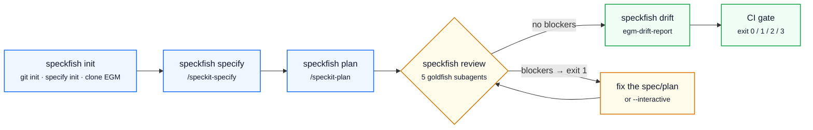

# speckfish 🐟

**Headless orchestrator for [Spec Kit](https://github.com/github/spec-kit) + [Elephant-Goldfish Model (EGM)](https://github.com/google/elephant-goldfish-model) over agent CLIs.**

`speckfish` turns the "specify → plan → review with Goldfish" loop into commands you can run
from a terminal or from CI. One agent subprocess per step, per-run artifacts, a
machine-readable verdict and exit codes you can automate against.


```
speckfish pipeline "a task CLI in Python" --stack "stdlib only" --gate
```

## The flow at a glance



Every step runs as its own subprocess, so the agent never drags context from the previous step:

```mermaid
sequenceDiagram
    autonumber
    participant CLI as speckfish
    participant SK as Spec Kit skills
    participant AG as agent CLI (claude / copilot / codex)
    participant GF as EGM goldfish subagents
    participant FS as .speckfish/runs/&lt;id&gt;/

    CLI->>AG: subprocess #1 with /speckit-specify
    AG->>SK: writes spec.md + checklists
    AG-->>FS: logs/specify.log, result JSON
    CLI->>AG: subprocess #2 with /speckit-plan
    AG->>SK: writes plan.md, research.md, contracts/
    CLI->>AG: subprocess #3 with /egm:egm-review
    AG->>GF: spawn reviewer (clean context, read-only tools)
    GF-->>AG: findings per stage
    AG-->>FS: artifacts/review/*.md + verdict
    CLI-->>CLI: parse verdict → blockers / majors / nits → exit code
```

## What it solves

- **Spec Kit** produces `spec.md` and `plan.md`, but nobody reviews them with a critical eye.
- **EGM** reviews with clean-context "goldfish" subagents, but its flow is interactive.
- `speckfish` joins both and runs them non-interactively, keeping every artifact the agent writes.

## Status (verified with real runs)

| Harness | Status | Evidence |
|---|---|---|
| **Claude Code** | ✅ Verified end-to-end | `specify` → `plan` → `egm-review` (7 subagents via `Agent`) → `egm-drift-report`; verdict through `--json-schema`; ~$0.85-1.04 per review |
| **GitHub Copilot CLI** | ✅ Verified end-to-end | full review: **10 subagents**, 0 blockers with the `speckit` profile, 8 majors; 4.9 AI credits, wall clock ~6m55s; drift in 0.63 credits / 64 s |
| **Codex CLI** | ⚠️ Unverified adapter | `codex exec`; needs install and login. See EGM `docs/codex.md` |

`speckfish` counts the subagents launched by each run (Claude: `subagent_stats.spawned`;
Copilot: `subagent.started` events) and stores it in the step result. That is the evidence that
a review was a real Goldfish review and not a same-context review.

EGM documents its Copilot adapter as **experimental** (reviewer isolation unverified by Google).
`speckfish` does not fix that: it records it.

## Install

```bash
# with uv (recommended)
uv tool install git+https://github.com/jamartif/speckfish

# or from a clone
git clone https://github.com/jamartif/speckfish && cd speckfish
uv venv && uv pip install -e .
```

Prebuilt wheels and sdists are attached to every release:
see <https://github.com/jamartif/speckfish/releases>.

Requirements: Python ≥ 3.10, plus the agent CLI you intend to use:

| Harness | Install | Login |
|---|---|---|
| Claude Code | `npm i -g @anthropic-ai/claude-code` | `claude` (once) |
| Copilot CLI | `npm i -g @github/copilot` | `copilot login` |
| Codex CLI | `npm i -g @openai/codex` | `codex login` |

Spec Kit is discovered automatically: the `specify` binary is used when it works and, if it is
blocked by Windows policies, `speckfish` falls back to `uv tool run --from specify-cli specify`.

## Usage

```bash
speckfish doctor                    # environment, harness, specify and EGM
speckfish init                      # git init + specify init + clone EGM into vendor/egm
speckfish specify "a JSON task CLI"
speckfish plan "Python 3.12, stdlib only"
speckfish review                    # reviews plan.md of the latest feature
speckfish review --profile none     # literal review against the EGM standard
speckfish drift                     # drift between spec and code
speckfish pipeline "idea" --stack "..." --gate --with-drift
speckfish runs && speckfish show
```

Global flags (before or after the subcommand): `--root`, `--harness claude|copilot|codex`,
`--json`, `--quiet`, `--dry-run`.

### Headless vs interactive

| Mode | Command | Behaviour |
|---|---|---|
| Headless (default) | `speckfish review` | One `-p` subprocess, no questions asked: the agent assumes defaults and the doubts show up later in the review report. Use it for CI and batch work. |
| Interactive | `speckfish review --interactive` | Launches the agent in **your terminal** (no `-p`): EGM renders its preset menu, asks for goldfish context and for line ranges, and you answer. Doubts get resolved on the spot instead of becoming assumptions. |

Both modes write the same artifacts to the same run directory; interactive runs are recorded with
`"interactive": true` in `state.json`. Interactive mode has no timeout and takes over the terminal,
so it is not meant for CI.

```bash
speckfish review --interactive                  # EGM asks, you decide
speckfish review --interactive --profile none   # same, literal EGM standard
```

What a real interactive run looks like (Claude Code, `plan.md` of a 75-line feature):

```
$ speckfish review --interactive
  Accessing workspace … Yes, I trust this folder
  → "Do you want to add more goldfish context? answer 'no extra context'"      → no extra context
  → menu: 1 interactive · 2 consolidated · 3 feature spec · 4 implementation · 5 type…
  → "Which ranges for the review?" 1 Stages 5-8 · 2 Stages 5-9 · 3 manual
  → Stage 5 written to artifacts/review/zoom_out_report.md
  exit 0 · 147.4s · state.json: {"interactive": true, "reports": [...], "blockers": 0}
```

### Exit codes

| Code | Meaning |
|---|---|
| `0` | step succeeded / review without blockers |
| `1` | review with blockers |
| `2` | execution error (timeout, budget, missing report) |
| `3` | incomplete environment (`doctor` fails) |

## How it works

1. **One subprocess per step.** `claude -p ...`, `copilot -p ...` or `codex exec ...`. Steps are
   never chained inside the same context: each one has to write its own artifact.
2. **Artifacts isolated per run.** Everything lands in `.speckfish/runs/<run-id>/`:
   `logs/<step>.log`, `artifacts/<step>/` (this is where EGM writes its reports, through
   `EGM artifact directory:`), `state.json` and `<step>.result.json`.
   That stops EGM from overwriting its fixed-name reports.
3. **`speckit` profile.** Without it, EGM judges a `plan.md` against its feature-spec standard and
   flags template-only sections as Blockers (missing *Alternatives Considered*, *Risks &
   Mitigations*…). The profile declares those out of scope and redirects the critique to
   consistency, mechanisms and technical risk. Measured: **2 Blockers → 0**, same cost.
4. **Structured verdict.** Claude gets `--json-schema` (`structured_output`: `verdict`,
   `blockers[]`, `majors`, `nits`, `reports[]`). For Copilot/Codex the consolidated Markdown
   report is parsed (tables or bullets, English or Spanish).
5. **Per-step cost limits.** `--max-budget-usd` (Claude) and `--max-ai-credits` (Copilot).
   Wall-clock timeout with process-tree kill: no agent CLI accepts `--timeout` or `--max-turns`,
   and `--print` can hang forever.
6. **EGM is never installed globally.** `--plugin-dir` points at `vendor/egm`, so user settings are
   untouched and the version is pinned in your repo.

## Observed cost (~75-line document)

| Step | Claude Code | Copilot CLI |
|---|---|---|
| specify | ~$0.26 / 49 s | — |
| plan | ~$0.21 / 46 s | — |
| review (`speckit` profile) | ~$1.0 / 4-5 min | 4.9 AI credits / ~7 min (10 subagents) |
| drift | ~$0.25 / 35 s | 0.63 AI credits / 64 s |

Figures come from each CLI's `total_cost_usd` / AI credits report; subscriptions are not billed the
same way. Always measure with `speckfish show`.

## Known limitations

- `structured_output` is a **soft contract**: when the model ignores it, parsing falls back to the
  Markdown report.
- EGM reports are free-form Markdown, so blocker/major/nit counts are heuristic.
- EGM can break the sequencing it promises with `Step=uninterrupted` (we have seen stage 6 launched
  in parallel with stage 5): keep the reports and never trust a single verdict blindly.
- `egm-brainstorm` / `egm-draft` run headless, but they are conversational by design: without a
  human they produce unvalidated hypotheses. Use them as draft generators.
- `pipeline` chains steps; `--gate` stops on the first failure or blocker.

## Development

```bash
uv venv && uv pip install -e . pytest
python -m pytest -q
```

No network and no agent CLI is invoked (only `--dry-run`). CI runs the suite on Ubuntu, macOS and
Windows for Python 3.10/3.12.

### Releasing

Push a tag and the release workflow builds the artifacts and attaches them to a GitHub release:

```bash
git tag v0.1.0 && git push origin v0.1.0
```

Each release ships the wheel and the source distribution, so a pinned version can be installed
without cloning:

```bash
uv tool install https://github.com/jamartif/speckfish/releases/download/v0.1.0/speckfish-0.1.0-py3-none-any.whl
```

## License

MIT. Spec Kit is GitHub's, EGM is Google's (Apache-2.0); this orchestrator does not modify them,
it only invokes them.
