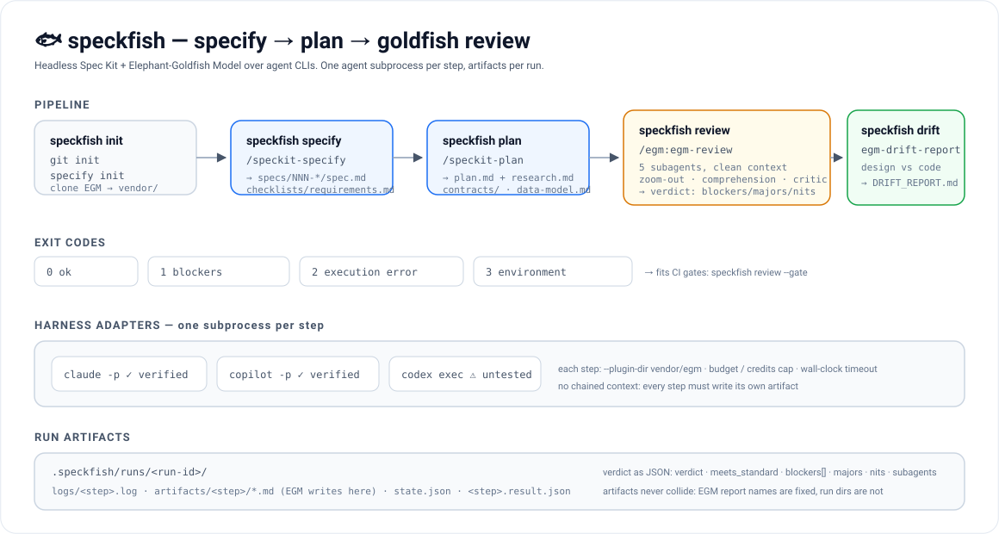
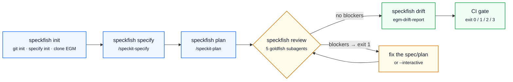

# speckfish 🐟

**Headless orchestrator for [Spec Kit](https://github.com/github/spec-kit) + [Elephant-Goldfish Model (EGM)](https://github.com/google/elephant-goldfish-model) over agent CLIs.**

[](https://github.com/jamartif/speckfish/actions/workflows/tests.yml)
[](https://github.com/jamartif/speckfish/releases)
[](pyproject.toml)
[](LICENSE)

`speckfish` turns the "specify → plan → review with Goldfish" loop into commands you can run
from a terminal or from CI. One agent subprocess per step, per-run artifacts, a
machine-readable verdict and exit codes you can automate against.



```
speckfish pipeline "a task CLI in Python" --stack "stdlib only" --gate
```

## The flow at a glance



Every step runs as its own subprocess, so the agent never drags context from the previous step:

```mermaid
sequenceDiagram
    autonumber
    participant CLI as speckfish
    participant SK as Spec Kit skills
    participant AG as agent CLI (claude / copilot / codex)
    participant GF as EGM goldfish subagents
    participant FS as .speckfish/runs/&lt;id&gt;/

    CLI->>AG: subprocess #1 with /speckit-specify
    AG->>SK: writes spec.md + checklists
    AG-->>FS: logs/specify.log, result JSON
    CLI->>AG: subprocess #2 with /speckit-plan
    AG->>SK: writes plan.md, research.md, contracts/
    CLI->>AG: subprocess #3 with /egm:egm-review
    AG->>GF: spawn reviewer (clean context, read-only tools)
    GF-->>AG: findings per stage
    AG-->>FS: artifacts/review/*.md + verdict
    CLI-->>CLI: parse verdict → blockers / majors / nits → exit code
```

## What it solves

- **Spec Kit** produces `spec.md` and `plan.md`, but nobody reviews them with a critical eye.
- **EGM** reviews with clean-context "goldfish" subagents, but its flow is interactive.
- `speckfish` joins both and runs them non-interactively, keeping every artifact the agent writes.

## Status (verified with real runs)

| Harness | Status | Evidence |
|---|---|---|
| **Claude Code** | ✅ Verified end-to-end | `specify` → `plan` → `egm-review` (7 subagents via `Agent`) → `egm-drift-report`; verdict through `--json-schema`; ~$0.85-1.04 per review |
| **GitHub Copilot CLI** | ✅ Verified end-to-end | full review: **10 subagents**, 0 blockers with the `speckit` profile, 8 majors; 4.9 AI credits, wall clock ~6m55s; drift in 0.63 credits / 64 s |
| **Codex CLI** | ⚠️ Unverified adapter | `codex exec`; needs install and login. See EGM `docs/codex.md` |

`speckfish` counts the subagents launched by each run (Claude: `subagent_stats.spawned`;
Copilot: `subagent.started` events) and stores it in the step result. That is the evidence that
a review was a real Goldfish review and not a same-context review.

EGM documents its Copilot adapter as **experimental** (reviewer isolation unverified by Google).
`speckfish` does not fix that: it records it.

## Install

```bash
# with uv (recommended)
uv tool install git+https://github.com/jamartif/speckfish

# or from a clone
git clone https://github.com/jamartif/speckfish && cd speckfish
uv venv && uv pip install -e .
```

Prebuilt wheels and sdists are attached to every release:
see <https://github.com/jamartif/speckfish/releases>.

Requirements: Python ≥ 3.10, plus the agent CLI you intend to use:

| Harness | Install | Login |
|---|---|---|
| Claude Code | `npm i -g @anthropic-ai/claude-code` | `claude` (once) |
| Copilot CLI | `npm i -g @github/copilot` | `copilot login` |
| Codex CLI | `npm i -g @openai/codex` | `codex login` |

Spec Kit is discovered automatically: the `specify` binary is used when it works and, if it is
blocked by Windows policies, `speckfish` falls back to `uv tool run --from specify-cli specify`.

### If the `speckfish.exe` launcher is blocked (Windows Device Guard / App Control)

Some managed Windows machines block the unsigned console-script `.exe` that pip/uv generates
(`'speckfish.exe' has been blocked by your organization's Device Guard policy`), while `python.exe`
runs fine. `uv tool install` puts the package in its own isolated venv, so `python -m speckfish`
fails with a plain `python` on PATH ("No module named speckfish") — pick one of these:

```powershell
# A) no installation at all
uv tool run --from git+https://github.com/jamartif/speckfish python -m speckfish doctor

# B) the interpreter of the installed tool
& "$env:APPDATA\uv\tools\speckfish\Scripts\python.exe" -m speckfish doctor

# C) install into a regular interpreter once, then `python -m speckfish` works in any folder
py -3.12 -m pip install --user git+https://github.com/jamartif/speckfish
python -m speckfish doctor

# D) or drop docs/speckfish.bat in a folder on PATH and run the plain command
speckfish doctor
```

Two Windows details worth knowing:

- `PATHEXT` resolves `.EXE` before `.BAT`, so a `speckfish.bat` never wins over the blocked
  `speckfish.exe`. Either `uv tool uninstall speckfish` (removing the stub) or call the `.bat`
  by another name.
- The `--user` install also generates an `.exe`; it is harmless because you never call it —
  `python -m speckfish` bypasses it.

On macOS and Linux the regular `speckfish` command works.

### Which agents does `init` set up?

`specify init --integration X` writes the Spec Kit skills **for one agent only** and records it in
`.specify/integration.json`. By default `speckfish init` picks every agent CLI it finds installed
(`claude`, `copilot`, `codex`) and runs Spec Kit once per integration; the skills land in each
agent's own folder:

| Integration | Where the skills go |
|---|---|
| `claude` | `.claude/skills/speckit-*` |
| `copilot` | `.github/skills/speckit-*` |
| `codex` | `.agents/skills/speckit-*` |

```bash
speckfish init                       # auto: every installed agent CLI
speckfish init --integration all     # claude + copilot + codex, even if a CLI is missing
speckfish init --integration copilot,claude
```

Two caveats worth knowing, both measured on Spec Kit 1.3.2:

- `integration.json` keeps only the **last** integration that ran (`installed_integrations` shows
  one entry). The previously written skill folders stay on disk and keep working; re-run
  `speckfish init` if that file drifts.
- Passing `--integration` twice to `specify` in one call does not merge: the last one wins. That is
  why `speckfish` runs Spec Kit once per integration instead of a single combined call.
- If an agent CLI is not installed, `speckfish` adds `--ignore-agent-tools` so Spec Kit still writes
  its skills instead of aborting.

EGM is independent of this: it is a single plugin mounted with `--plugin-dir vendor/egm`, so the
review works with any of the three agents regardless of which Spec Kit integration you installed.

## Usage

```bash
speckfish doctor                    # environment, harness, specify and EGM
speckfish init                      # git init + specify init + clone EGM into vendor/egm
speckfish init --integration all    # install Spec Kit skills for claude, copilot and codex

# Spec Kit, step by step
speckfish constitution "tests first, no hidden state"   # project principles
speckfish specify "a JSON task CLI"
speckfish plan "Python 3.12, stdlib only"
speckfish tasks                     # tasks.md from the design
speckfish analyze                   # spec vs plan vs tasks consistency
speckfish checklist "error handling"
speckfish clarify                   # open questions (writes questions.md when headless)
speckfish implement --yes           # DESTRUCTIVE: writes code and tests
speckfish converge                  # append whatever the code still misses to tasks.md

# EGM review
speckfish review                    # reviews plan.md of the latest feature
speckfish review --profile none     # literal review against the EGM standard
speckfish review --interactive      # EGM asks, you answer
speckfish drift                     # drift between spec/code

speckfish pipeline "idea" --stack "..." --gate --with-drift
speckfish pipeline "idea" --stack "..." --with-tasks --with-analyze --gate

# housekeeping
speckfish --version
speckfish config                         # show project defaults
speckfish config harness=copilot         # store them in .speckfish/config.json
speckfish runs                           # steps, cost and duration per run
speckfish show                           # per-step table + run total
speckfish runs --clean --keep 5          # prune old runs
```

Every Spec Kit skill is a subcommand (the same nine `speckit-*` skills the integration installs).
`implement` is the only destructive one: it refuses to run without `--yes`.

Global flags (before or after the subcommand): `--root`, `--harness claude|copilot|codex`,
`--json`, `--quiet`, `--dry-run`.

### One feature at a time (or all of them)

Spec Kit works on **one feature at a time**: the one in `.specify/feature.json`. That means
`speckfish plan`, `tasks`, `analyze`, `checklist`, `converge` and `implement` all act on the *active*
feature — by default the last one you specified, not on every spec in the repo.

```bash
speckfish features                       # what exists, what each one has, which one is active
speckfish plan "Swift 6" --feature 002   # switch the active feature and plan that one
speckfish tasks --feature 002            # same idea for any other step
speckfish implement --yes --feature 002
```

```
$ speckfish features
  001-json-task-cli                  [++-]
  002-open-remember-repos            [+--]
  003-safe-staging-commit            [+--]
* 009-settings-preferences           [+--]

* active (Spec Kit will work on it)   [+spec +plan +tasks]
```

`--feature` accepts a number (`002`), a directory name (`002-open-remember-repos`) or a path, and it
**writes `.specify/feature.json`** — the same file Spec Kit reads — plus tells the agent in the prompt
which folder to work on. A missing feature fails with the list of what exists instead of guessing.

`speckfish review` and `drift` already take an explicit document/directory, so they do not care which
feature is active:

```bash
speckfish review specs/002-open-remember-repos/spec.md
speckfish drift specs/003-safe-staging-commit
```

Looping over every feature is deliberately not automatic yet: planning eight features is eight paid
agent runs. If you want a batch mode (`plan --all-features`), ask for it and it gets built.

### Big briefs: split before specifying

Spec Kit allows **one feature per `/speckit-specify` invocation**, so a brief describing three ideas
lands in a single mixed spec (measured: a 3-request brief produced one `spec.md` containing all of
them). Use `--split` to cut it first:

```bash
speckfish specify @docs/brief.md --split                  # up to 6 features
speckfish specify @docs/brief.md --split --max-features 4
```

It makes two kinds of call: an inventory that must answer with JSON (`{"features": [...]}`) and then
one `/speckit-specify` per feature, each with a self-contained description. Everything lands in one
run (`runs/<id>/split.json` + `specify-N.result.json`), and the console lists what it decided:

```
run 20261113-2043: 3 feature(s)
  - exports CSV reports
  - tags and filtering
  - shared work file
  [ok] split 41s cost=1.1 credits
  [ok] specify-1 152s cost=2.2 credits
```

Cost is one extra model call for the inventory. If the inventory says it is a single feature, you get
one spec — same as without `--split`. Always review the split list before planning: the split is a
reading of your brief, not a requirement.

Add `--review` and EGM reviews each spec as soon as it is written (one goldfish review per feature, so
this multiplies the cost: budget it):

```bash
speckfish specify @docs/brief.md --split --review     # split, specify and goldfish-review each spec
speckfish specify "one feature" --review              # same for a single spec
```

Without `--review`, specifying never calls EGM: `review` is its own step (`speckfish review`) and the
usual place to run it is on the `plan.md`, once the technical decisions exist.

### Passing a Markdown file as input

Any step that takes text accepts a file instead: prefix the argument with `@`, or pass a path that
clearly is one (`.md`, `.markdown`, `.txt`, `.rst`). Small files (under 12 KB) are inlined into the
prompt; bigger ones are referenced by absolute path so the agent reads them itself.

```bash
speckfish constitution @.specify/memory/constitution-template.md   # your own principles file
speckfish constitution docs/team-constitution.md                 # same, without the @
speckfish specify @docs/brief.md                                 # a written brief instead of a line
speckfish plan @docs/stack.md                                    # constraints from a document
speckfish checklist @docs/quality.md
```

Real run on this machine: `constitution @constitution-template.md` produced a Spec Kit
`constitution.md` with the five principles of the template formalised (with its version/Sync Impact
Report), 133 s, 1.33 AI credits with Copilot.

Relative paths resolve against `--root`; a missing file fails loudly instead of being sent as text.
`review` and `drift` take a path natively — they do not need the `@`.

### Use it from VS Code (Copilot, Claude, Codex)

`speckfish editors` writes the entry points each tool documents, so the same steps are one
slash command or one task away:

`speckfish init` generates them **by default** (all four targets); use `--no-editors` to skip it, or
regenerate later:

```bash
speckfish editors                     # vscode + copilot + claude + codex
speckfish editors --targets claude    # only what you use
speckfish editors --prefix sf         # shorter slash commands: /sf-review
speckfish init --no-editors           # project setup without editor files
```

| Target | Files | How you invoke it |
|---|---|---|
| `vscode` | `.vscode/tasks.json` | Command Palette → **Run Task** → *spfish: review* (works with any agent, no extension needed) |
| `copilot` | `.github/prompts/spfish-*.prompt.md` | Copilot Chat: `/spfish-review`, `/spfish-specify`, `/spfish-plan`, `/spfish-drift`, `/spfish-doctor` |
| `claude` | `.claude/commands/spfish-*.md` | Claude Code: `/spfish-review` (custom slash commands, merged into skills) |
| `codex` | `$CODEX_HOME/prompts/spfish-*.md` (default `~/.codex/prompts`) | Codex CLI/IDE: `/prompts:spfish-review` |

The prefix is short on purpose: Spec Kit installs its own `/speckit-*` commands, and a long
`/speckfish-*` prefix made both families show up together when you typed `/speck`. Change it with
`--prefix` (e.g. `speckfish editors --prefix sf`).

Every generated file runs the real CLI in the integrated terminal and then tells the agent to read
`.speckfish/runs/<id>/state.json` and the Markdown reports, so the chat answer contains the verdict
and costs instead of a guess. They never edit the documents themselves.

Two details that matter:

- The generated command is auto-detected: `speckfish` when the binary works, `python -m speckfish`
  when Device Guard blocks it (override with `--command`).
- Codex prompts are user-global (that is where Codex looks), not per-repo: point them elsewhere with
  `--codex-home`. Everything else lives in the repo and can be committed.

`--no-force` keeps files you have already edited.

### Which agent runs, and which model

`speckfish init --integration all` only writes **Spec Kit skills** for every agent. It does not
decide who runs the steps. The executor is picked independently, from `--harness`, `SPECKFISH_HARNESS`
or `.speckfish/config.json`, and defaults to `auto` = the first agent CLI found installed, in this
order: **claude → copilot → codex**.

| Question | How it is decided |
|---|---|
| Which agent runs `specify`/`plan`/`review` | `--harness claude\|copilot\|codex` (also accepted after the subcommand), `SPECKFISH_HARNESS`, or `harness` in `.speckfish/config.json`; default `auto` |
| Which model | you do not choose one by default: the agent CLI uses its own default/pinned model. Force it with `--model <name>` (forwarded to `claude --model`, `copilot --model`, `codex --model`) |
| What actually ran | every step records `harness` and `model` in `state.json` and `<step>.result.json`; the summary line prints `model: …` |

Measured on this machine (defaults, no `--model`):

| Harness | Model the CLI picked | Where it comes from |
|---|---|---|
| Claude Code | `claude-sonnet-5-5` | `modelUsage` in the JSON result |
| Copilot CLI | `gpt-6-luna` (with `mai-code-1.1-flash` for short turns) | `model.call_final_result` events in the JSONL |
| Codex CLI | n/a | not tested here |

```bash
speckfish specify "a JSON task CLI"                     # auto → claude on this machine
speckfish specify "a JSON task CLI" --harness copilot   # same work, Copilot
speckfish review --model claude-opus-4                 # pin the model for one step
```

Mixing is fine: skills installed for all three, execution with whichever agent you point at.

### Headless vs interactive

| Mode | Command | Behaviour |
|---|---|---|
| Headless (default) | `speckfish review` | One `-p` subprocess, no questions asked: the agent assumes defaults and the doubts show up later in the review report. Use it for CI and batch work. |
| Interactive | `speckfish review --interactive` | Launches the agent in **your terminal** (no `-p`): EGM renders its preset menu, asks for goldfish context and for line ranges, and you answer. Doubts get resolved on the spot instead of becoming assumptions. |

Both modes write the same artifacts to the same run directory; interactive runs are recorded with
`"interactive": true` in `state.json`. Interactive mode has no timeout and takes over the terminal,
so it is not meant for CI.

```bash
speckfish review --interactive                  # EGM asks, you decide
speckfish review --interactive --profile none   # same, literal EGM standard
```

What a real interactive run looks like (Claude Code, `plan.md` of a 75-line feature):

```
$ speckfish review --interactive
  Accessing workspace … Yes, I trust this folder
  → "Do you want to add more goldfish context? answer 'no extra context'"      → no extra context
  → menu: 1 interactive · 2 consolidated · 3 feature spec · 4 implementation · 5 type…
  → "Which ranges for the review?" 1 Stages 5-8 · 2 Stages 5-9 · 3 manual
  → Stage 5 written to artifacts/review/zoom_out_report.md
  exit 0 · 147.4s · state.json: {"interactive": true, "reports": [...], "blockers": 0}
```

### Exit codes

| Code | Meaning |
|---|---|
| `0` | step succeeded / review without blockers |
| `1` | review with blockers |
| `2` | execution error (timeout, budget, missing report) |
| `3` | incomplete environment (`doctor` fails) |

## How it works

1. **One subprocess per step.** `claude -p ...`, `copilot -p ...` or `codex exec ...`. Steps are
   never chained inside the same context: each one has to write its own artifact.
2. **Artifacts isolated per run.** Everything lands in `.speckfish/runs/<run-id>/`:
   `logs/<step>.log`, `artifacts/<step>/` (this is where EGM writes its reports, through
   `EGM artifact directory:`), `state.json` and `<step>.result.json`.
   That stops EGM from overwriting its fixed-name reports.
3. **`speckit` profile.** Without it, EGM judges a `plan.md` against its feature-spec standard and
   flags template-only sections as Blockers (missing *Alternatives Considered*, *Risks &
   Mitigations*…). The profile declares those out of scope and redirects the critique to
   consistency, mechanisms and technical risk. Measured: **2 Blockers → 0**, same cost.
4. **Structured verdict.** Claude gets `--json-schema` (`structured_output`: `verdict`,
   `blockers[]`, `majors`, `nits`, `reports[]`). For Copilot/Codex the consolidated Markdown
   report is parsed (tables or bullets, English or Spanish).
5. **Per-step cost limits.** `--max-budget-usd` (Claude) and `--max-ai-credits` (Copilot).
   Wall-clock timeout with process-tree kill: no agent CLI accepts `--timeout` or `--max-turns`,
   and `--print` can hang forever.
6. **EGM is never installed globally.** `--plugin-dir` points at `vendor/egm`, so user settings are
   untouched and the version is pinned in your repo.

## Observed cost (~75-line document)

| Step | Claude Code | Copilot CLI |
|---|---|---|
| specify | ~$0.26 / 49 s | — |
| plan | ~$0.21 / 46 s | — |
| review (`speckit` profile) | ~$1.0 / 4-5 min | 4.9 AI credits / ~7 min (10 subagents) |
| drift | ~$0.25 / 35 s | 0.63 AI credits / 64 s |

Figures come from each CLI's `total_cost_usd` / AI credits report; subscriptions are not billed the
same way. Always measure with `speckfish show`.

## Known limitations

- `structured_output` is a **soft contract**: when the model ignores it, parsing falls back to the
  Markdown report.
- EGM reports are free-form Markdown, so blocker/major/nit counts are heuristic.
- EGM can break the sequencing it promises with `Step=uninterrupted` (we have seen stage 6 launched
  in parallel with stage 5): keep the reports and never trust a single verdict blindly.
- `egm-brainstorm` / `egm-draft` run headless, but they are conversational by design: without a
  human they produce unvalidated hypotheses. Use them as draft generators.
- `pipeline` chains steps; `--gate` stops on the first failure or blocker.

## Development

```bash
uv venv && uv pip install -e . pytest
python -m pytest -q
```

No network and no agent CLI is invoked (only `--dry-run`).

CI runs on Ubuntu and Windows (Python 3.10/3.12) on every push — that is the badge above. macOS lives
in its own workflow (`tests-macos.yml`, weekly + tags + manual) because this account's macOS runners
currently queue for many minutes and then get cancelled without running a single step; that says
nothing about the code. The suite is platform-neutral (`pathlib`, no shell assumptions) and passes on
Windows and Linux; run `python -m pytest -q` locally on a Mac to check it there.

### Releasing

Push a tag and the release workflow builds the artifacts and attaches them to a GitHub release:

```bash
git tag v0.1.0 && git push origin v0.1.0
```

Each release ships the wheel and the source distribution, so a pinned version can be installed
without cloning:

```bash
uv tool install https://github.com/jamartif/speckfish/releases/download/v0.1.0/speckfish-0.1.0-py3-none-any.whl
```

## License

MIT. Spec Kit is GitHub's, EGM is Google's (Apache-2.0); this orchestrator does not modify them,
it only invokes them.
